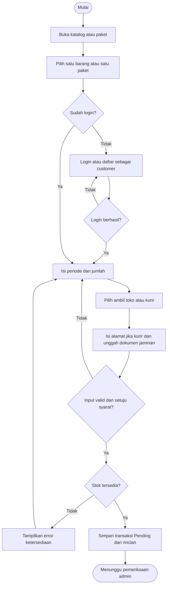
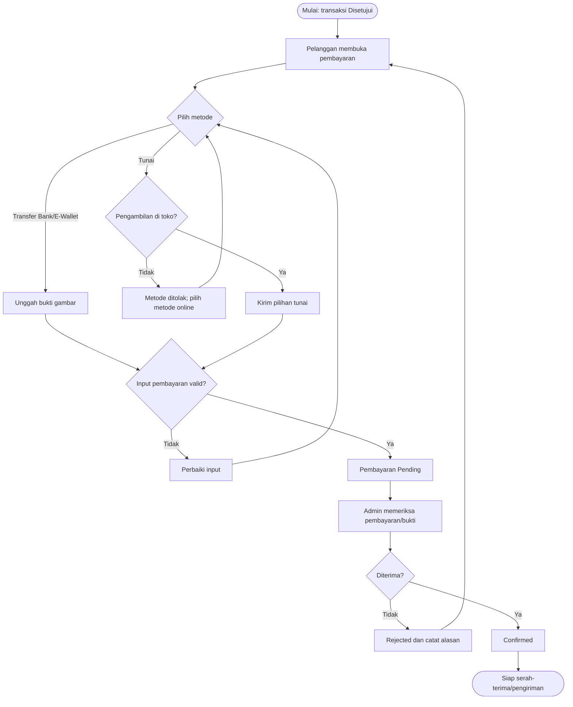
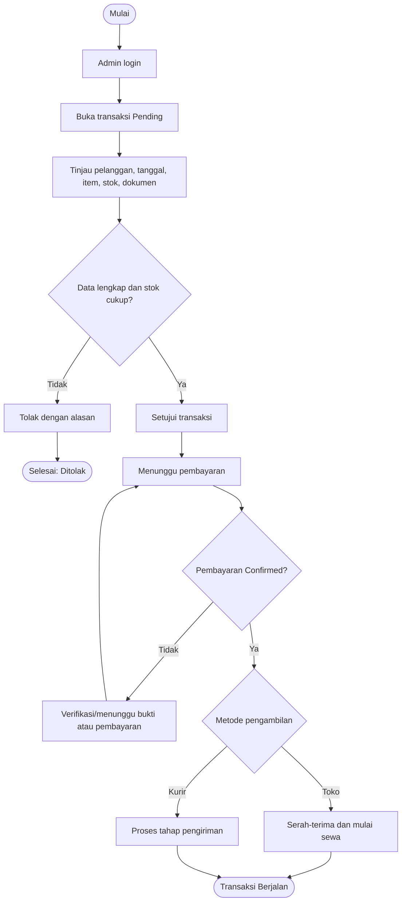
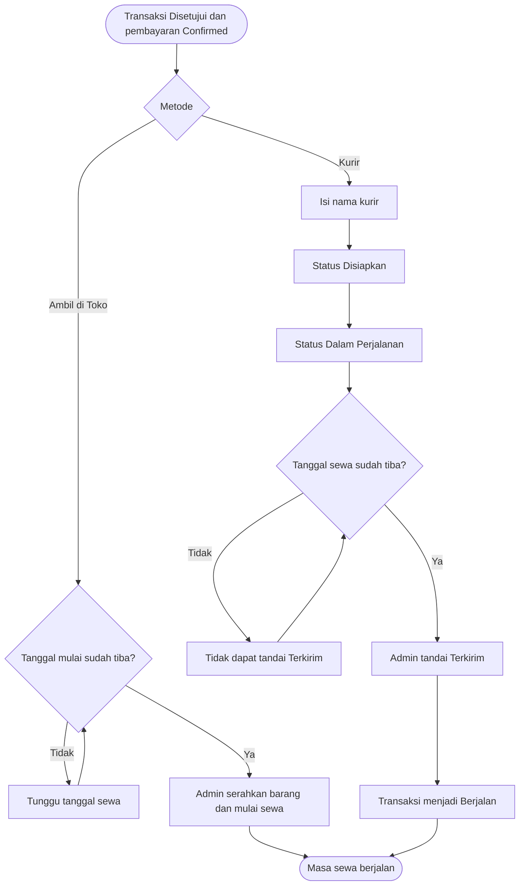
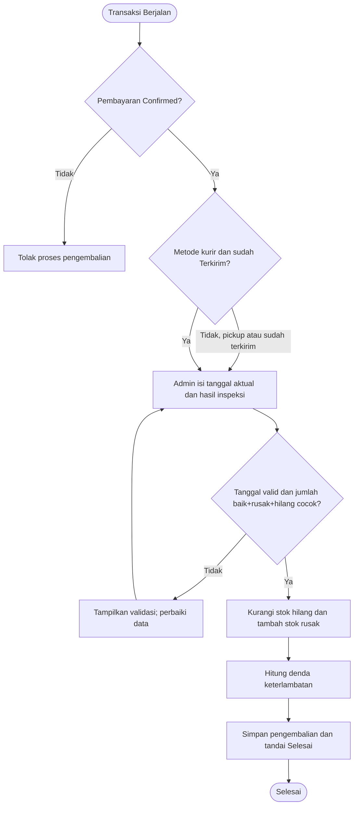
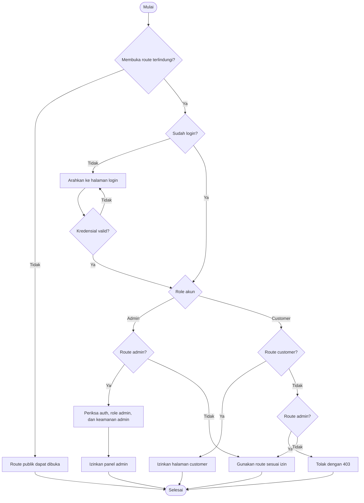
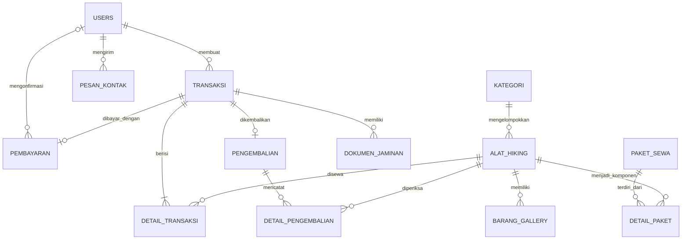

# Product Requirements Document (PRD)

## HIKETRIP Rental

| Informasi | Keterangan |
|---|---|
| Versi dokumen | 1.0 |
| Tanggal analisis | 10 November 2026 |
| Status | Dokumentasi kondisi implementasi repository |
| Repository | [adityaa1402/rental-hiking](https://github.com/adityaa1402/rental-hiking) |
| Dasar analisis | README, panduan penggunaan, route, controller, model, migration, view, seeder, dan automated test yang tersedia |

> **Catatan pembacaan:** “Tersedia” berarti ada implementasi yang dapat ditelusuri di kode. “Belum tersedia” berarti tidak ditemukan alur atau route implementasinya saat analisis. Tidak ditemukan daftar roadmap resmi; karena itu, rekomendasi pengembangan pada dokumen ini tidak dianggap sebagai rencana yang telah disetujui.

## A. Informasi Umum

### A.1 Nama dan jenis aplikasi

- **Nama proyek:** HIKETRIP Rental.
- **Jenis aplikasi:** Aplikasi web penyewaan perlengkapan hiking berbasis Laravel.
- **Teknologi utama yang terkonfirmasi:** PHP 8.2+, Laravel 12, Blade, Bootstrap, MySQL/MariaDB untuk penggunaan lokal sesuai panduan, Composer, serta Node.js/npm untuk aset frontend.
- **Tujuan produk:** Mengelola katalog, pengajuan sewa barang atau paket, transaksi, pembayaran, proses ambil/kirim, dan pemeriksaan barang kembali.

Sumber: [README.md](../README.md), [composer.json](../composer.json), [Panduan Penggunaan dan Alur Rental](../PANDUAN_PENGGUNA.md).

### A.2 Latar belakang dan permasalahan

Penyewaan perlengkapan hiking memerlukan pencatatan barang, jumlah stok layak pakai, harga per hari, jadwal sewa, bukti jaminan, pembayaran, dan kondisi barang yang dikembalikan. Jika proses itu dikelola terpisah atau manual, risiko yang perlu dikendalikan antara lain data barang ganda, benturan stok pada periode sewa, pencatatan pembayaran yang tidak terhubung ke pesanan, serta tidak adanya catatan kondisi barang setelah kembali.

Repository tidak menyediakan hasil wawancara pengguna atau dokumen proses bisnis sebelumnya. Uraian permasalahan di atas merupakan konteks masalah yang ditangani fitur aplikasi, bukan klaim hasil survei.

### A.3 Tujuan pengembangan

1. Menyediakan informasi katalog barang dan paket sewa untuk calon pelanggan.
2. Memungkinkan pengguna terdaftar mengirim pengajuan penyewaan.
3. Membantu admin memeriksa ketersediaan, menyetujui atau menolak pengajuan, memverifikasi pembayaran, dan memproses serah-terima.
4. Mencatat penerimaan kembali serta kondisi baik, rusak, atau hilang.
5. Mengelola data barang, kategori, paket, pengguna pelanggan, pesan kontak, pengaturan toko, dan laporan transaksi dari panel admin.

### A.4 Manfaat sistem

- **Pelanggan:** dapat mencari informasi barang/paket, mengajukan sewa, mengirim bukti pembayaran, dan melihat transaksi sendiri.
- **Admin:** mendapat satu panel untuk mengelola inventaris, transaksi, pembayaran, pengiriman, pengembalian, pesan, dan ringkasan.
- **Operasional toko:** mempunyai catatan tanggal, status, biaya, dan rincian barang yang terkait dengan transaksi.

Manfaat di atas adalah manfaat potensial dari fungsi yang tersedia; repository tidak memuat pengukuran dampak operasional.

### A.5 Target pengguna

1. **Pengunjung:** melihat halaman publik, katalog, paket, dan mengirim pesan kontak.
2. **Pelanggan terdaftar:** mengajukan sewa dan mengakses transaksi/profil miliknya.
3. **Admin:** mengelola fungsi administrasi setelah login dengan akun ber-role `admin`.

## B. Analisis Kebutuhan

### B.1 Sistem yang berjalan di repository

Pengunjung dapat membuka halaman publik, mencari dan memfilter katalog, melihat detail produk/paket, serta mengirim formulir kontak. Booking memerlukan sesi login. Pengajuan disimpan sebagai transaksi `Pending`, kemudian admin memeriksa dan menyetujui atau menolak. Setelah disetujui, pelanggan mengirim pilihan pembayaran dan—untuk pembayaran online—bukti pembayaran. Admin memverifikasi pembayaran, lalu menjalankan serah-terima toko atau status pengiriman kurir. Admin memproses pengembalian dengan menghitung jumlah baik/rusak/hilang, memperbarui stok, menghitung denda keterlambatan, dan menutup transaksi.

Sumber utama: [routes/web.php](../routes/web.php), [BookingController.php](../app/Http/Controllers/BookingController.php), [TransaksiController.php](../app/Http/Controllers/Admin/TransaksiController.php), [Customer PaymentController.php](../app/Http/Controllers/Customer/PaymentController.php), [Admin PaymentController.php](../app/Http/Controllers/Admin/PaymentController.php), [PengembalianController.php](../app/Http/Controllers/Admin/PengembalianController.php), [Panduan Penggunaan dan Alur Rental](../PANDUAN_PENGGUNA.md).

### B.2 Solusi yang ditawarkan

Sistem menyediakan katalog berbasis data, penyimpanan transaksi dan detail barang, validasi stok berdasarkan periode, pemisahan status transaksi dengan status pembayaran/pengiriman, serta pencatatan hasil pemeriksaan pengembalian. Pengelolaan administrasi dibatasi dengan autentikasi dan pemeriksaan role.

### B.3 Kebutuhan fungsional

Prioritas MoSCoW: **Must Have** = fungsi inti untuk alur sewa pada implementasi saat ini; **Should Have** = fungsi pendukung operasional; **Could Have** = fungsi tambahan yang sudah tersedia tetapi bukan syarat menyelesaikan sewa; **Won't Have (saat ini)** = fungsi tidak ditemukan dalam implementasi dan tidak diasumsikan telah direncanakan.

| ID | Kebutuhan fungsional | Prioritas | Kondisi |
|---|---|---|---|
| FR-01 | Sistem menyediakan halaman publik, informasi toko, katalog, kategori, dan daftar paket aktif. | Must Have | Tersedia |
| FR-02 | Pengunjung dapat mencari, memfilter kategori, mengurutkan, dan melihat detail barang; katalog menghindari listing duplikat menurut identitas yang digunakan aplikasi. | Should Have | Tersedia |
| FR-03 | Sistem menampilkan detail paket aktif beserta komponennya dan harga paket per hari. | Must Have | Tersedia |
| FR-04 | Pengguna dapat mendaftar sebagai `customer`, login, logout, dan mendapatkan halaman sesuai role. | Must Have | Tersedia |
| FR-05 | Pengguna yang login dapat mengajukan satu barang **atau** satu paket, menentukan tanggal/jumlah/metode ambil atau kirim, mengisi dokumen jaminan, serta menyetujui syarat. | Must Have | Tersedia |
| FR-06 | Sistem memvalidasi rentang tanggal, jumlah, pilihan barang/paket, dokumen, alamat kurir, dan stok pada periode sewa. | Must Have | Tersedia |
| FR-07 | Sistem menyimpan transaksi berstatus awal `Pending` beserta snapshot harga dan rincian unit barang. | Must Have | Tersedia |
| FR-08 | Pelanggan dapat melihat daftar/detail transaksi miliknya dan membatalkan transaksi yang masih `Pending`. | Must Have | Tersedia |
| FR-09 | Admin dapat menyetujui/menolak pengajuan; persetujuan memeriksa kembali stok dan status transaksi. | Must Have | Tersedia |
| FR-10 | Pelanggan dapat memilih Transfer Bank/E-Wallet dengan bukti gambar, atau Tunai di Toko untuk transaksi ambil di toko. | Must Have | Tersedia sebagai pencatatan manual; gateway tidak ditemukan |
| FR-11 | Admin dapat memeriksa, mengonfirmasi, atau menolak pembayaran pending; alasan penolakan disimpan sebagai catatan. | Must Have | Tersedia |
| FR-12 | Admin dapat mencatat tahapan pengiriman kurir dan data kurir/resi. | Should Have | Tersedia |
| FR-13 | Admin dapat mencatat serah-terima toko dan memulai sewa sesuai aturan tanggal dan pembayaran. | Must Have | Tersedia |
| FR-14 | Admin dapat memeriksa setiap jenis barang kembali, mencatat jumlah baik/rusak/hilang, memperbarui stok, menghitung denda keterlambatan, dan menyelesaikan transaksi. | Must Have | Tersedia |
| FR-15 | Admin dapat mengelola data barang, kategori, dan paket sewa. | Must Have | Tersedia |
| FR-16 | Admin dapat mengelola galeri foto tambahan untuk barang. | Could Have | Tersedia |
| FR-17 | Admin dapat melihat data pelanggan dan pesan kontak (termasuk tautan akun jika pengirim login). | Should Have | Tersedia; balasan pesan tidak ditemukan |
| FR-18 | Admin dapat mengubah pengaturan toko, biaya pengiriman datar, dan tarif denda harian. | Should Have | Tersedia |
| FR-19 | Admin dapat melihat, mencetak, dan mengekspor ringkasan/laporan transaksi. | Should Have | Tersedia; batas status/filter berbeda antar keluaran |
| FR-20 | Sistem menyediakan pengaturan ulang password melalui email, verifikasi email, pembayaran otomatis, refund, notifikasi email/SMS, dan integrasi API kurir. | Won't Have (saat ini) | Tidak ditemukan alur implementasi; rekomendasi perlu konfirmasi |

### B.4 Kebutuhan nonfungsional

| ID | Kebutuhan nonfungsional | Dasar/kondisi |
|---|---|---|
| NFR-01 | Route admin hanya dapat digunakan oleh pengguna terautentikasi dengan role admin; route pelanggan dibatasi untuk role customer. | Middleware `auth`, `role`, dan `admin.security` pada [routes/web.php](../routes/web.php). |
| NFR-02 | Login membatasi percobaan POST melalui middleware throttle 5 kali per menit; password akun disimpan melalui mekanisme hashing Laravel. | [routes/web.php](../routes/web.php), [AuthController.php](../app/Http/Controllers/AuthController.php), [User.php](../app/Models/User.php). |
| NFR-03 | Formulir memvalidasi tipe, panjang, rentang, keunikan, dan/atau keberadaan data sebelum penyimpanan. | Aturan ada di controller terkait; tingkat cakupan berbeda tiap form. |
| NFR-04 | Unggahan gambar/dokumen transaksi memakai allowlist tipe dan batas ukuran 3 MB pada alur booking/pembayaran/produk/paket. | Controller terkait; batas berbeda untuk galeri (per file). |
| NFR-05 | Perubahan multi-tabel booking, paket, pembayaran, persetujuan stok, dan pengembalian menggunakan transaksi database pada alur tertentu. | Controller terkait. |
| NFR-06 | Penentuan stok menggunakan kondisi barang dan overlap tanggal; persetujuan mengunci record terkait untuk mengurangi konflik persetujuan bersamaan. | [AlatHiking.php](../app/Models/AlatHiking.php), [Admin TransaksiController.php](../app/Http/Controllers/Admin/TransaksiController.php). |
| NFR-07 | Tampilan menggunakan Blade, Bootstrap, dan layout responsif; beberapa pengujian UI memeriksa pagination dan panel responsif. | Views di `resources/views/`; tes terpilih ada di `tests/Feature/`. |
| NFR-08 | Sistem harus dapat dipelihara melalui pola MVC Laravel, migration, seeder, dan automated test yang tersedia. | Struktur repository. |
| NFR-09 | Sasaran kapasitas, waktu respons, ketersediaan layanan, backup, retensi berkas pribadi, dan pemantauan produksi belum ditetapkan pada repository. | Perlu keputusan pemilik sistem sebelum deployment produksi. |

### B.5 Kebutuhan perangkat

| Jenis | Kebutuhan yang didukung oleh dokumentasi | Catatan |
|---|---|---|
| Server pengembangan | PHP 8.2+, Composer, MySQL/MariaDB, Node.js dan npm. | Mengikuti [README.md](../README.md) dan [Panduan Penggunaan dan Alur Rental](../PANDUAN_PENGGUNA.md). |
| Browser/perangkat pengguna | Browser modern dengan dukungan HTML/CSS/JavaScript dan koneksi ke server web. | Browser minimum dan ukuran layar minimum tidak dispesifikasikan. |
| CPU/RAM/storage server | Belum ditentukan. | Tidak mengarang spesifikasi minimum; tentukan berdasarkan jumlah pengguna/berkas dan lingkungan deployment. |
| Produksi | Konfigurasi hosting, domain HTTPS, backup, email, dan layanan pembayaran tidak dijelaskan sebagai setup produksi. | Perlu analisis deployment tersendiri. |

### B.6 Asumsi dan batasan

- Pengguna baru yang mendaftar diberi role `customer`; tidak ada form pendaftaran admin.
- Akun demo tersedia melalui seeder, bukan mekanisme onboarding produksi. Kredensial demo di panduan hanya untuk lokal dan harus diganti/dihapus sebelum penggunaan nyata.
- Metode pembayaran adalah input/pencatatan manual Transfer Bank, E-Wallet, atau Tunai di Toko. Tidak ditemukan integrasi payment gateway.
- “Kirim via Kurir” mencatat status dan data kurir/resi dari admin; tidak ada integrasi tracking pihak ketiga.
- Nominal biaya dan tarif bawaan adalah nilai default konfigurasi, bukan tarif bisnis yang dijamin berlaku permanen.
- Tidak ada SLA, kebijakan retensi dokumen jaminan, persetujuan privasi dokumen identitas, atau kebijakan refund yang terdefinisi lengkap dalam repository.
- Migrasi dasar tabel rental mengandung `dropIfExists` untuk tabel inti ketika migrasi itu dijalankan. Perlakukan migrasi awal dengan kehati-hatian pada database yang sudah berisi data; jangan menjalankannya ulang secara manual tanpa backup dan tinjauan migrasi.

## C. Ruang Lingkup

### C.1 Termasuk dalam sistem

| Area | Kondisi saat analisis |
|---|---|
| Halaman beranda, tentang, kontak, katalog, detail barang, daftar/detail paket | Tersedia |
| Registrasi, login, logout, batas akses role, dashboard pelanggan/admin | Tersedia |
| Pengajuan sewa barang/paket, validasi tanggal/jumlah/stok, dokumen jaminan | Tersedia |
| Persetujuan/penolakan transaksi, pembatalan transaksi pending | Tersedia |
| Catatan metode pembayaran, unggah bukti, konfirmasi/penolakan admin | Tersedia secara manual |
| Pengambilan di toko, status pengiriman kurir, pengembalian dan pemeriksaan stok | Tersedia |
| CRUD barang, kategori, paket, galeri gambar barang, pengaturan toko | Tersedia |
| Data pelanggan, pesan kontak, laporan cetak/CSV | Tersedia |

### C.2 Tidak termasuk atau belum dapat dikonfirmasi

| Area | Kondisi |
|---|---|
| Payment gateway dan settlement otomatis | Tidak ditemukan |
| Refund uang dan proses status `Refunded` operasional | Enum/status database ada, proses refund tidak ditemukan |
| Reset password/email verification | Tabel/feld pendukung framework ada, route dan alur aplikasi tidak ditemukan |
| Balasan pesan pelanggan melalui panel admin | Tidak ditemukan; admin hanya melihat daftar dan detail pesan |
| Integrasi kurir, pelacakan otomatis, notifikasi pelanggan otomatis | Tidak ditemukan |
| Penghitungan biaya kerusakan/kehilangan terpisah | Tidak ditemukan; kode mencatat kondisi dan mengubah stok, denda yang dihitung adalah denda keterlambatan |
| Multi-cabang, multi-gudang, atau multi-role/permission granular | Tidak ditemukan |
| Aplikasi mobile native | Tidak ditemukan |
| Roadmap fitur resmi | Tidak ditemukan; ide pengembangan di PRD ini sebatas rekomendasi |

## D. Fitur Utama

### D.1 Katalog perlengkapan hiking

| Elemen | Penjelasan |
|---|---|
| Tujuan | Membantu pengunjung menemukan barang yang layak ditampilkan untuk disewa. |
| Aktor | Pengunjung, pelanggan; admin mengelola data sumber barang. |
| Alur | Buka katalog → cari berdasarkan nama/merek/deskripsi → filter kategori → urutkan harga/nama/terbaru → buka detail. |
| Input | Query pencarian, slug kategori, dan pilihan pengurutan. |
| Proses | Katalog memuat barang kondisi `Baik`, menghindari listing duplikat berdasarkan nama, merek, kategori, kondisi, dan menampilkan sisa stok berdasarkan logika ketersediaan. |
| Output | Kartu/list barang, harga harian, kategori, gambar, dan status/sisa stok. |
| Aturan bisnis | Barang dengan kondisi selain `Baik` tidak dianggap tersedia untuk disewa. Stok tersedia dikurangi unit rusak dan unit pada transaksi `Disetujui`/`Berjalan` dengan tanggal yang overlap. |
| Kondisi gagal | Slug barang tidak ditemukan menghasilkan 404; filter/pencarian tanpa hasil menampilkan kondisi kosong. Stok dapat berubah sebelum admin menyetujui. |
| Bukti | [KatalogController.php](../app/Http/Controllers/KatalogController.php), [AlatHiking.php](../app/Models/AlatHiking.php), `resources/views/katalog/`. |

### D.2 Detail produk dan paket sewa

| Elemen | Penjelasan |
|---|---|
| Tujuan | Menampilkan spesifikasi barang atau rincian komponen/harga paket sebelum booking. |
| Aktor | Pengunjung dan pelanggan. |
| Alur | Buka detail barang melalui slug, atau detail paket aktif → tinjau deskripsi, harga dan komponen → lanjut ke booking. |
| Input | Slug barang/paket dan pilihan tombol booking. |
| Proses | Detail mengambil kategori/galeri untuk barang dan daftar `detail_paket` beserta barangnya untuk paket. Paket publik difilter `status_aktif = 1`. |
| Output | Informasi deskriptif, harga per hari, foto, komponen, dan tautan booking. |
| Aturan bisnis | Paket booking harus aktif dan mempunyai item. Harga paket digunakan sebagai dasar biaya paket, bukan jumlah harga komponen satu per satu. |
| Kondisi gagal | Barang/paket atau slug tidak ditemukan; paket nonaktif tidak ditampilkan pada route publik dan tidak dapat dibooking. |
| Bukti | [KatalogController.php](../app/Http/Controllers/KatalogController.php), [PaketController.php](../app/Http/Controllers/PaketController.php), [BookingController.php](../app/Http/Controllers/BookingController.php). |

### D.3 Registrasi, login, dan pembagian akses

| Elemen | Penjelasan |
|---|---|
| Tujuan | Mengidentifikasi pelanggan dan melindungi fungsi pribadi/admin. |
| Aktor | Pengunjung, pelanggan, admin. |
| Alur | Pengunjung mendaftar sebagai customer atau login → session diregenerasi sesudah autentikasi → diarahkan sesuai role → logout menghapus sesi dan membuat token baru. |
| Input | Nama, email, nomor HP, password, konfirmasi password, serta email/password untuk login. |
| Proses | Validasi email unik, hash password, pemeriksaan kredensial, throttle 5 POST login per menit, dan redirect role. |
| Output | Dashboard pelanggan atau dashboard admin. |
| Aturan bisnis | Registrasi selalu membuat role `customer`. Akses `/admin/*` memerlukan autentikasi dan role `admin`; akses `/customer/*` memerlukan role `customer`. |
| Kondisi gagal | Kredensial salah menampilkan error; password registrasi minimal 8 karakter; pengguna ber-role salah menerima 403; pengunjung diarahkan ke login. |
| Batasan | Verifikasi email dan proses lupa/reset password tidak ditemukan. |
| Bukti | [AuthController.php](../app/Http/Controllers/AuthController.php), [RoleMiddleware.php](../app/Http/Middleware/RoleMiddleware.php), [AdminSecurityMiddleware.php](../app/Http/Middleware/AdminSecurityMiddleware.php), [routes/web.php](../routes/web.php). |

### D.4 Pengajuan penyewaan

| Elemen | Penjelasan |
|---|---|
| Tujuan | Membuat permintaan sewa barang tunggal atau satu paket. |
| Aktor | Pengguna yang login; antarmuka pelanggan ditujukan untuk role customer. |
| Alur | Pilih barang/paket → login bila belum login → isi tanggal, jumlah, metode pengambilan, dokumen jaminan, catatan → setujui syarat → kirim → transaksi menjadi `Pending`. |
| Input | Tepat satu `alat_id` atau `paket_id`; tanggal sewa/kembali; jumlah; metode ambil/kirim; alamat kurir jika dikirim; catatan; tipe/dokumen jaminan; persetujuan syarat. |
| Proses | Validasi tanggal dan jumlah; cek stok setiap komponen; simpan total dan detail transaksi dengan snapshot harga; simpan dokumen jaminan pada storage publik. |
| Output | Nomor kode transaksi, transaksi Pending, dan pesan bahwa pengajuan menunggu admin. |
| Aturan bisnis | Tanggal mulai minimal hari ini; tanggal kembali harus setelah tanggal mulai; jumlah 1–10; metode `Ambil di Toko` atau `Kirim via Kurir`; dokumen wajib bertipe KTP/SIM/Paspor dan file jpg/png/pdf/webp maksimal 3 MB; persetujuan syarat wajib. Alamat wajib untuk pengiriman kurir. |
| Kondisi gagal | Tidak memilih atau memilih dua jenis produk; item tidak ditemukan; paket nonaktif/tanpa komponen; stok tidak cukup; input/file tidak valid; syarat tidak disetujui. |
| Batasan | Pengajuan `Pending` belum mengurangi stok pada kalkulasi ketersediaan; stok diperiksa ulang saat admin menyetujui. |
| Bukti | [BookingController.php](../app/Http/Controllers/BookingController.php), [DetailTransaksi.php](../app/Models/DetailTransaksi.php). |

### D.5 Pengelolaan transaksi

| Elemen | Penjelasan |
|---|---|
| Tujuan | Mengelola permintaan sejak diajukan sampai transaksi selesai/ditolak/dibatalkan. |
| Aktor | Pelanggan untuk melihat transaksi sendiri dan membatalkan Pending; admin untuk memeriksa dan mengubah status. |
| Alur | Pelanggan melihat daftar/detail → admin meninjau booking → admin menyetujui atau menolak → transaksi berlanjut ke pembayaran/serah-terima atau berhenti. |
| Input | Status/filter pencarian, keputusan admin, alasan penolakan, tindakan pembatalan customer. |
| Proses | Transaksi menyimpan pelanggan, periode, item, harga, biaya, catatan, status, dan kode. Admin mengunci transaksi dan item stok saat persetujuan serta memvalidasi stok ulang. |
| Output | Status `Pending`, `Disetujui`, `Berjalan`, `Selesai`, `Ditolak`, atau `Dibatalkan`; catatan admin/catatan penolakan. |
| Aturan bisnis | Customer hanya mengambil transaksi yang `id_user`-nya sendiri. Customer hanya dapat membatalkan transaksi `Pending`. Admin hanya dapat menyetujui/menolak yang Pending. |
| Kondisi gagal | Status telah berubah, rincian item kosong, barang tidak ada, atau stok pada periode tidak lagi cukup. |
| Bukti | [Customer TransaksiController.php](../app/Http/Controllers/Customer/TransaksiController.php), [Admin TransaksiController.php](../app/Http/Controllers/Admin/TransaksiController.php), [Transaksi.php](../app/Models/Transaksi.php). |

### D.6 Pembayaran dan status pembayaran

| Elemen | Penjelasan |
|---|---|
| Tujuan | Mencatat pilihan pembayaran dan proses verifikasi pembayaran setelah booking disetujui. |
| Aktor | Pelanggan dan admin. |
| Alur | Transaksi disetujui → pelanggan memilih Transfer Bank/E-Wallet lalu mengunggah bukti, atau memilih Tunai di Toko untuk pickup → admin memeriksa → Confirmed atau Rejected. |
| Input | Metode pembayaran, bukti gambar untuk pembayaran online, keterangan, alasan admin jika menolak. |
| Proses | Satu record pembayaran per transaksi; nominal mengikuti `total_harga`; bukti online disimpan pada public storage; perubahan status dikunci/transaksional pada proses tertentu. |
| Output | Pembayaran `Pending`, `Confirmed`, atau `Rejected`; bukti dan catatan verifikasi. |
| Aturan bisnis | Form hanya tersedia untuk transaksi yang dimiliki pelanggan dan berstatus `Disetujui`. Online wajib bukti gambar JPG/JPEG/PNG/WEBP maksimal 3 MB. Tunai hanya boleh untuk pengambilan di toko. Pembayaran Confirmed tidak dapat dikirim ulang. Transaksi tidak dapat dimulai sebelum pembayaran Confirmed. |
| Kondisi gagal | Transaksi bukan milik user, bukan status Disetujui, sudah Confirmed, metode tidak diizinkan, bukti tidak valid/tidak ada, atau admin mencoba verifikasi status yang bukan Pending. |
| Batasan | Tidak ditemukan gateway, pemanggilan API bank/e-wallet, autodebit, atau refund flow. Status `Refunded` hanya tercantum pada enum/model. |
| Bukti | [Customer PaymentController.php](../app/Http/Controllers/Customer/PaymentController.php), [Admin PaymentController.php](../app/Http/Controllers/Admin/PaymentController.php), [Pembayaran.php](../app/Models/Pembayaran.php). |

### D.7 Pengiriman atau pengambilan barang

| Elemen | Penjelasan |
|---|---|
| Tujuan | Mencatat cara serah-terima barang dan tahapan pengiriman yang dikelola admin. |
| Aktor | Admin; pelanggan melihat informasi/status melalui detail transaksi. |
| Alur pickup | Transaksi Disetujui + pembayaran Confirmed + tanggal mulai tiba → admin menandai sewa berjalan saat barang diserahkan. |
| Alur kurir | Setelah transaksi disetujui dan pembayaran Confirmed, admin mengisi nama kurir dan memulai `Disiapkan` → `Dalam Perjalanan` → `Terkirim`; tahap Terkirim mengubah transaksi menjadi Berjalan. |
| Input | Metode pickup/kurir, alamat saat kurir, nama/telepon kurir, nomor resi, tindakan tahap pengiriman. |
| Output | Status pengiriman, waktu dikirim/diterima, dan catatan admin. |
| Aturan bisnis | Nama kurir wajib ketika tahap pertama disiapkan. Status Terkirim tidak boleh ditetapkan sebelum tanggal mulai sewa. |
| Kondisi gagal | Bukan transaksi kurir, transaksi belum disetujui/dibayar, langkah tidak sesuai urutan, nama kurir kosong, atau waktu pengiriman belum memenuhi aturan tanggal. |
| Batasan | Tidak ada API kurir atau tracking otomatis. |
| Bukti | [Admin TransaksiController.php](../app/Http/Controllers/Admin/TransaksiController.php), migration [delivery tracking](../database/migrations/2026_11_09_090000_add_delivery_tracking_to_transaksi_table.php). |

### D.8 Inventaris dan ketersediaan

| Elemen | Penjelasan |
|---|---|
| Tujuan | Menjaga agar unit rusak tidak dihitung layak sewa dan mengurangi benturan stok pada tanggal yang sama. |
| Aktor | Admin mengubah inventaris; sistem menampilkan ketersediaan ke pengunjung/pelanggan. |
| Alur | Admin mencatat barang, harga, kondisi dan stok → katalog menampilkan listing layak → booking memeriksa rentang → persetujuan admin mengecek ulang secara terkunci. |
| Input | Kategori, nama, merek, deskripsi, spesifikasi, harga/hari, stok total, stok rusak, kondisi, gambar/galeri. |
| Proses | Tersedia = stok total − stok rusak − jumlah pada transaksi Disetujui/Berjalan yang periodenya overlap; hasil minimum nol. Barang bukan kondisi Baik memiliki sisa stok nol. |
| Output | Daftar inventaris dan jumlah ketersediaan menurut logika aplikasi. |
| Aturan bisnis | Duplikasi listing ditentukan oleh kombinasi nama barang, merek, kategori, dan kondisi; ini bukan ID aset fisik atau serial number. |
| Kondisi gagal | Nilai stok/harga invalid, duplikat listing, kategori tidak ditemukan, gambar tidak valid, atau perubahan kondisi menyebabkan barang tidak tersedia. |
| Batasan | Tidak ditemukan pemesanan/hold stok saat Pending, nomor seri per unit, maupun multi-gudang. |
| Bukti | [AlatHiking.php](../app/Models/AlatHiking.php), [BarangController.php](../app/Http/Controllers/Admin/BarangController.php), [Admin TransaksiController.php](../app/Http/Controllers/Admin/TransaksiController.php). |

### D.9 Pengembalian dan pemeriksaan barang

| Elemen | Penjelasan |
|---|---|
| Tujuan | Mencatat penerimaan barang, kondisi unit dan dampaknya pada stok/denda. |
| Aktor | Admin. Pelanggan dapat melihat informasi pengembalian pada transaksi miliknya. |
| Alur | Transaksi Berjalan dan pembayaran Confirmed → untuk kurir, pastikan status Terkirim → admin mengisi tanggal aktual dan jumlah baik/rusak/hilang setiap barang → simpan → transaksi Selesai. |
| Input | Tanggal aktual, ringkasan kondisi, rincian jumlah tiap barang, catatan. |
| Proses | Sistem memvalidasi setiap jenis barang tepat satu kali dan jumlah total harus sama dengan jumlah yang disewa. Stok fisik dikurangi unit hilang; stok rusak bertambah untuk unit rusak; denda dihitung berdasarkan hari terlambat dan tarif harian pengaturan. |
| Output | Record pengembalian/detail, perubahan stok, nilai denda, transaksi Selesai. |
| Aturan bisnis | Tanggal aktual tidak boleh di masa depan atau sebelum tanggal mulai sewa. Pengembalian hanya dapat diproses sekali melalui status Berjalan. |
| Kondisi gagal | Pembayaran belum Confirmed, transaksi belum Berjalan, kurir belum Terkirim, jumlah hasil inspeksi tidak cocok, barang tidak ada, atau stok tidak konsisten. |
| Batasan | Tidak ditemukan biaya penggantian barang rusak/hilang terpisah dari pembaruan inventaris dan denda keterlambatan. |
| Bukti | [PengembalianController.php](../app/Http/Controllers/Admin/PengembalianController.php), [Pengembalian.php](../app/Models/Pengembalian.php), [DetailPengembalian.php](../app/Models/DetailPengembalian.php). |

### D.10 Dashboard dan pengelolaan admin

| Elemen | Penjelasan |
|---|---|
| Tujuan | Memberi admin ringkasan operasional dan akses untuk mengelola data. |
| Aktor | Admin. |
| Alur | Login admin → dashboard → pilih modul barang/kategori/paket/customer/pesan/transaksi/pembayaran/pengembalian/laporan/pengaturan. |
| Input | Data CRUD, filter, pencarian, status, dan berkas sesuai modul. |
| Proses | Controller admin memvalidasi dan menyimpan data melalui model/database; route dilindungi middleware admin. |
| Output | Statistik stok/transaksi/pendapatan, daftar data, hasil perubahan, laporan cetak/CSV, atau error validasi. |
| Aturan bisnis | Admin saja yang dapat mengakses route `/admin/*`. Penghapusan kategori ditolak jika masih memiliki barang. |
| Kondisi gagal | Tidak terautentikasi → login; role non-admin → 403; record tidak ada → 404; validasi atau konflik bisnis gagal → pesan error. |
| Batasan/catatan | Label “Total Pendapatan” laporan menghitung `total_harga` transaksi berstatus Disetujui/Berjalan/Selesai, bukan ledger kas yang dikonfirmasi; tanggal filter menggunakan `created_at`. Pada index tersedia filter status, sedangkan cetak/CSV hanya menerapkan tanggal. |
| Bukti | [Admin DashboardController.php](../app/Http/Controllers/Admin/DashboardController.php), [LaporanController.php](../app/Http/Controllers/Admin/LaporanController.php), [routes/web.php](../routes/web.php). |

## E. Role dan Hak Akses

| Role | Deskripsi | Hak akses/fitur | Batasan |
|---|---|---|---|
| Pengunjung (belum login) | Pengguna publik tanpa akun. | Beranda, tentang, katalog/detail, paket/detail, kontak, registrasi, login. | Tidak dapat membuka route booking yang memerlukan auth, halaman customer, atau area admin. |
| Customer | Akun yang dibuat lewat registrasi atau seeder. | Membuat booking melalui UI, melihat/membatalkan transaksi milik sendiri jika Pending, membayar transaksi yang disetujui, melihat/update profil dan password, mengirim pesan kontak. | Tidak dapat membuka `/admin/*`; data transaksi dibatasi `id_user` sendiri; pembatalan hanya Pending; Tunai hanya pickup toko. |
| Admin | Akun dengan `role = admin`. | Dashboard, inventaris/kategori/paket/galeri, daftar pelanggan, pesan kontak, transaksi, pembayaran, pengiriman, pengembalian, laporan, pengaturan. | Route admin memerlukan login dan role admin; bukan semua pengguna yang berhasil login otomatis menjadi admin. |

Sumber: [routes/web.php](../routes/web.php), [RoleMiddleware.php](../app/Http/Middleware/RoleMiddleware.php), [AdminSecurityMiddleware.php](../app/Http/Middleware/AdminSecurityMiddleware.php), [AuthController.php](../app/Http/Controllers/AuthController.php), [User.php](../app/Models/User.php).

> Catatan implementasi: route `/booking` dikelompokkan dengan middleware `auth` dan tidak mencantumkan `role:customer`; antarmuka serta alur pendaftaran ditujukan untuk customer, tetapi pembatasan route booking secara eksplisit ke customer tidak tampak di deklarasi route.

## F. User Flow dan Flowchart

Notasi: oval = mulai/selesai, kotak = proses, belah ketupat = keputusan.

### F.1 Pelanggan melakukan penyewaan

### F.2 Pembayaran dan konfirmasi transaksi

### F.3 Admin mengelola pesanan

### F.4 Pengiriman atau pengambilan barang

### F.5 Pengembalian dan pemeriksaan barang

### F.6 Login dan pembagian akses

## G. Aturan Bisnis

| Area | Aturan aktual yang ditemukan |
|---|---|
| Registrasi | Nama wajib, email wajib dan unik, nomor HP wajib, password dikonfirmasi dan minimal 8 karakter; role ditetapkan `customer`. |
| Login | Memerlukan email/password; login sukses meregenerasi session; login gagal memberi pesan umum; POST login memakai throttle 5/menit. |
| Pilihan booking | Harus tepat satu jenis: barang atau paket. |
| Tanggal | `tgl_sewa` harus hari ini atau sesudahnya; `tgl_kembali` harus setelah `tgl_sewa`. Durasi memakai selisih tanggal dengan minimum satu hari. |
| Jumlah booking | Integer minimum 1 maksimum 10 untuk jumlah barang/paket yang dipesan. Paket mengalikan kebutuhan tiap komponen dengan jumlah paket. |
| Ketersediaan | Barang harus kondisi `Baik`. Stok layak = `stok_total - stok_rusak - unit` pada transaksi Disetujui/Berjalan yang overlap; minimum nol. Pending tidak masuk perhitungan pemakaian. |
| Persetujuan stok | Admin memeriksa ulang stok saat menyetujui dalam transaksi DB dengan penguncian item untuk mengurangi persetujuan bentrok. |
| Harga | Barang: harga harian × unit × durasi. Paket: harga paket harian × jumlah paket × durasi. Harga barang per detail disimpan sebagai snapshot. |
| Biaya tambahan | Biaya kurir flat dari pengaturan toko ditambahkan jika `Kirim via Kurir`; default migration Rp25.000. Diskon booking disimpan 0 pada alur booking. |
| Dokumen jaminan | Tipe KTP/SIM/Paspor; file wajib jpg/png/pdf/webp, maksimum 3 MB. Data file terkait transaksi dicatat di `dokumen_jaminan`. |
| Status transaksi | Status database: Pending, Disetujui, Berjalan, Selesai, Ditolak, Dibatalkan. Persetujuan/penolakan hanya untuk Pending; customer membatalkan hanya Pending. |
| Pembayaran | Pilihan: Transfer Bank, E-Wallet, Tunai di Toko. Tunai hanya jika pickup toko; transfer/e-wallet harus mengunggah bukti. Pembayaran perlu Confirmed sebelum sewa dimulai. |
| Status pembayaran | Pending, Confirmed, Rejected, Refunded (enum). Proses yang ditemukan: Pending → Confirmed atau Rejected; alur Refunded tidak ditemukan. |
| Pickup toko | Admin menandai transaksi Berjalan setelah pembayaran Confirmed dan tanggal sewa tiba; tindakan mulai tidak digunakan untuk transaksi kurir. |
| Pengiriman | Tahap berurutan: null → Disiapkan → Dalam Perjalanan → Terkirim. Nama kurir wajib pada tahap Disiapkan. Status Terkirim mengubah transaksi menjadi Berjalan dan tanggal sewa harus tiba. |
| Pengembalian | Hanya transaksi Berjalan dengan pembayaran Confirmed; kurir harus sudah Terkirim. Tanggal aktual tidak boleh masa depan atau sebelum tanggal mulai sewa. |
| Pemeriksaan | Setiap jenis barang harus tercatat tepat satu kali; baik + rusak + hilang wajib sama dengan jumlah yang disewa. |
| Perubahan inventaris saat kembali | Jumlah hilang mengurangi stok total; jumlah rusak menambah stok rusak; barang baik tidak menambah stok total karena unit sebelumnya tetap tercatat dalam stok fisik. |
| Denda | `max(0, hari terlambat) × denda_keterlambatan_per_hari`; default migration Rp50.000/hari. Tidak ditemukan denda kerusakan/kehilangan dalam perhitungan. |
| Kategori | Tidak dapat dihapus bila masih mempunyai barang. |
| Laporan | Laporan utama mengecualikan Ditolak/Dibatalkan, memakai transaksi Disetujui/Berjalan/Selesai; nominal yang dijumlahkan adalah `total_harga`. |

Sumber inti: [BookingController.php](../app/Http/Controllers/BookingController.php), [helpers.php](../app/Helpers/helpers.php), [AlatHiking.php](../app/Models/AlatHiking.php), [Admin TransaksiController.php](../app/Http/Controllers/Admin/TransaksiController.php), [Customer PaymentController.php](../app/Http/Controllers/Customer/PaymentController.php), [Admin PaymentController.php](../app/Http/Controllers/Admin/PaymentController.php), [PengembalianController.php](../app/Http/Controllers/Admin/PengembalianController.php), [LaporanController.php](../app/Http/Controllers/Admin/LaporanController.php).

## H. Data dan Database

### H.1 Tabel aplikasi

| Tabel | Fungsi dan atribut penting | Primary key dan relasi |
|---|---|---|
| `users` | Akun; `nama_lengkap`, `email`, `password`, `role`, `no_hp`, `alamat`, timestamps. | PK `id`; direferensikan transaksi, pesan, dan konfirmasi pembayaran. Role enum `admin`/`customer`. |
| `kategori` | Kategori barang; `nama_kategori`, `slug`, `deskripsi`, `icon`. | PK `id_kategori`; satu kategori mempunyai banyak `alat_hiking`. |
| `alat_hiking` | Master barang; kategori, nama/slug, merek, deskripsi, spesifikasi, harga harian, stok total/rusak, kondisi, gambar. | PK `id_alat`; FK `id_kategori`; direferensikan detail paket/transaksi/pengembalian/galeri. |
| `barang_gallery` | Foto tambahan dan urutan galeri barang; gambar, keterangan, urutan. | PK `id_gallery`; FK `id_alat` dengan cascade delete. |
| `paket_sewa` | Paket; nama/slug, deskripsi, kapasitas, harga paket/hari, gambar, status aktif. | PK `id_paket`; mempunyai banyak `detail_paket`. |
| `detail_paket` | Komponen dan jumlah alat per paket. | PK `id_detail_paket`; FK `id_paket` (cascade) dan `id_alat`. |
| `transaksi` | Header sewa; kode unik, user, tanggal, hari, subtotal, biaya kirim, diskon, denda, total, metode/alamat, status, catatan, status/data/waktu pengiriman. | PK `id_transaksi`; FK `id_user`; mempunyai detail, dokumen, pembayaran, dan pengembalian. |
| `detail_transaksi` | Barang/unit pada transaksi, snapshot harga per hari, subtotal. | PK `id_detail`; FK `id_transaksi` (cascade) dan `id_alat`. |
| `dokumen_jaminan` | Metadata file jaminan dan tipenya per transaksi. | PK `id_dokumen`; FK `id_transaksi` (cascade). |
| `pembayaran` | Nominal, metode, status, bukti/keterangan, admin konfirmasi, tanggal konfirmasi. | PK `id_pembayaran`; `id_transaksi` unik/FK; `dikonfirmasi_oleh` FK user nullable. |
| `pengembalian` | Ringkasan tanggal, kondisi, jumlah agregat baik/rusak/hilang, denda, catatan, admin. | PK `id_pengembalian`; FK `id_transaksi`; kolom `id_admin` ada tetapi foreign key tidak didefinisikan pada migration yang diperiksa. |
| `detail_pengembalian` | Jumlah baik/rusak/hilang per barang yang diperiksa. | PK `id_detail_pengembalian`; FK `id_pengembalian` cascade dan `id_alat`; unique pasangan pengembalian/barang. |
| `pesan_kontak` | Pesan publik; nama, email, subjek, isi, timestamps, user nullable. | PK `id_pesan`; FK `id_user` nullable, null saat akun dihapus. |
| `pengaturan` | Nama toko, kontak, alamat/jam, biaya kurir flat, denda harian, syarat-ketentuan. | PK `id_pengaturan`; dipakai sebagai record pengaturan toko. |

### H.2 Tabel pendukung Laravel

Migration juga membuat tabel pendukung framework: `migrations` (riwayat migrasi), `password_reset_tokens` (dibuat oleh migration bawaan, tetapi route reset aplikasi tidak ditemukan), `sessions`, `cache`, `cache_locks`, `jobs`, `job_batches`, dan `failed_jobs`. Tabel-tabel ini bukan modul bisnis rental.

### H.3 Relasi utama

`o|--o{` menggambarkan akun admin pengonfirmasi yang nullable pada tabel pembayaran. Model menyatakan satu pembayaran dan satu pengembalian per transaksi; migration memberi unique constraint untuk `pembayaran.id_transaksi`, tetapi tidak terlihat unique constraint pada `pengembalian.id_transaksi`.

### H.4 Migration utama

Skema inti: [create_hiketrip_tables migration](../database/migrations/2026_01_01_000010_create_hiketrip_tables.php). Perubahan fitur: [galeri barang](../database/migrations/2026_11_05_120000_create_barang_gallery_table.php), [tracking pengiriman](../database/migrations/2026_11_09_090000_add_delivery_tracking_to_transaksi_table.php), [detail inspeksi inventaris](../database/migrations/2026_11_10_090000_add_return_item_inventory_tracking.php), [pesan kontak](../database/migrations/2026_11_10_100000_create_pesan_kontak_table.php), [relasi user pesan](../database/migrations/2026_11_10_110000_add_user_id_to_pesan_kontak_table.php).

## I. Keamanan, Kualitas, dan Batasan Nonfungsional

### I.1 Keamanan yang ditemukan

- Middleware `auth`, `role:admin/customer`, dan `admin.security` melindungi route yang dideklarasikan.
- POST login dibatasi 5 kali per menit; Laravel session diregenerasi pada login dan invalidasi pada logout.
- Password menggunakan cast `hashed` pada model User dan `Hash::make` di beberapa alur.
- Form Laravel menggunakan CSRF token; middleware admin juga memeriksa token pada metode POST/PUT/DELETE/PATCH dan menambah security headers.
- File unggahan divalidasi tipe dan ukuran pada controller.
- Tampilan bukti pembayaran diakses melalui route admin yang memeriksa direktori, keberadaan file, dan MIME gambar.
- Akses data transaksi pelanggan dibatasi dengan `id_user` aktif.

### I.2 Hal yang perlu ditinjau sebelum produksi

- Dokumen jaminan KTP/SIM/Paspor disimpan pada disk `public` dan proses penyajiannya/retensi harus ditinjau agar data identitas tidak dapat diakses pihak tidak berwenang.
- Pastikan HTTPS, `APP_DEBUG=false`, secret/key, kredensial demo, backup database/berkas, kebijakan penyimpanan, dan permission filesystem dikelola di deployment.
- Throttle yang terlihat diterapkan ke POST login; batas percobaan untuk registrasi, upload, atau endpoint lain belum dinyatakan di kode yang ditinjau.
- Penggunaan `storage:link` direkomendasikan panduan untuk file publik; hak akses bukti pembayaran dibatasi melalui controller, namun lokasi file tetap pada storage public disk.
- Security test yang tersedia membuktikan perilaku route admin dasar, bukan audit keamanan penuh.

### I.3 Kinerja dan pemeliharaan

Repository memakai pagination pada sejumlah daftar dan eager-loading pada beberapa relasi, tetapi tidak menetapkan target load, ukuran data, cache strategi bisnis, availability, maupun SLA. Kebutuhan tersebut perlu ditentukan sebelum deployment dengan skala pengguna nyata.

## J. Kriteria Penerimaan dan Pengujian

### J.1 Acceptance criteria fitur

| ID | Kriteria penerimaan |
|---|---|
| AC-01 | Pengunjung dapat membuka halaman publik/katalog/paket, dan item yang tidak layak tidak dihitung tersedia untuk disewa. |
| AC-02 | Registrasi valid membuat akun customer; login admin/customer diarahkan sesuai role. |
| AC-03 | Pengunjung tanpa login yang membuka route terlindungi diarahkan ke login; customer tidak dapat membuka dashboard admin. |
| AC-04 | Booking menerima tepat satu barang/paket, menolak tanggal atau jumlah invalid, dan tidak menyimpan jika stok komponen tidak cukup. |
| AC-05 | Booking valid menyimpan transaksi Pending, detail barang, snapshot harga, biaya pengiriman jika kurir, dan metadata dokumen jaminan. |
| AC-06 | Admin hanya dapat menyetujui transaksi Pending dan sistem memeriksa ulang stok sebelum status berubah. |
| AC-07 | Pembayaran hanya dapat dikirim untuk transaksi milik customer dengan status Disetujui; tunai hanya untuk pickup; pembayaran Confirmed tidak dapat diubah lewat form pelanggan. |
| AC-08 | Transaksi hanya dapat dimulai setelah pembayaran Confirmed; metode kurir mengikuti tahap pengiriman berurutan. |
| AC-09 | Pengembalian menolak tanggal/jumlah inspeksi tidak valid; pengembalian valid memperbarui stok, menghitung denda keterlambatan, dan menandai transaksi Selesai. |
| AC-10 | Customer hanya melihat transaksi miliknya; role non-admin tidak dapat mengakses admin; perubahan form divalidasi. |
| AC-11 | Laporan admin menampilkan transaksi pada status yang termasuk query laporan, dan cetak/CSV menyajikan kode transaksi. |

### J.2 Pengujian yang benar-benar dijalankan

Pada 10 November 2026 dijalankan `php artisan test`: **25 tests passed, 116 assertions**. Status berikut hanya diberikan untuk skenario yang terwakili pada automated test suite.

| ID | Skenario | Langkah pengujian | Hasil yang diharapkan | Status pengujian |
|---|---|---|---|---|
| TC-01 | Guest membuka route admin | Jalankan tes `AdminAuthenticationTest` pada `/admin` dan `/admin/dashboard`. | Redirect ke login. | **Lulus** |
| TC-02 | Customer membuka dashboard admin | Autentikasi sebagai customer lalu GET `/admin/dashboard`. | HTTP 403. | **Lulus** |
| TC-03 | Admin login | Kirim email/password admin melalui route login. | Redirect dashboard admin dan terautentikasi. | **Lulus** |
| TC-04 | Password registrasi minimum | Jalankan `RegistrationPasswordTest` untuk password 7 dan 8 karakter. | 7 ditolak, 8 diterima. | **Lulus** |
| TC-05 | Keunikan barang | Jalankan `AdminBarangDuplicateTest` untuk daftar, tambah, dan edit duplikat. | Duplikat disembunyikan/ditolak sesuai skenario tes. | **Lulus** |
| TC-06 | Pengelolaan item paket | Jalankan `AdminPaketManagementTest` untuk form, gambar, update status/item, dan input item duplikat/kosong. | Validasi dan persistensi sesuai assertion tes. | **Lulus** |
| TC-07 | Pesan kontak | Jalankan `ContactMessageTest` untuk simpan, hubungan customer, akses admin, dan pembatasan customer. | Pesan tersimpan/terlihat admin; customer ditolak dari halaman admin. | **Lulus** |
| TC-08 | Update email profil | Jalankan `CustomerProfileUpdateTest`. | Email valid tersimpan; email pengguna lain ditolak. | **Lulus** |
| TC-09 | Katalog/home total kategori | Jalankan `HomeCategoryCountTest`. | Perhitungan kategori mengikuti barang unik yang dites. | **Lulus** |
| TC-10 | Pagination | Jalankan `PaginationLayoutTest`. | Kontrol pagination ringkas sesuai tes. | **Lulus** |
| TC-11 | Booking end-to-end | Buat booking melalui UI, validasi ketersediaan, dan simpan jaminan. | Booking tersimpan Pending sesuai aturan. | **Belum ada automated test end-to-end pada suite yang diperiksa** |
| TC-12 | Upload/verifikasi pembayaran | Upload bukti, coba metode tunai/kurir, konfirmasi dan penolakan admin. | Status dan batasan pembayaran mengikuti aturan. | **Belum ada automated test pada suite yang diperiksa** |
| TC-13 | Pengiriman dan serah-terima | Uji pickup dan urutan status kurir termasuk batas tanggal. | Status tidak dapat melompati aturan. | **Belum ada automated test pada suite yang diperiksa** |
| TC-14 | Pemeriksaan pengembalian | Uji jumlah baik/rusak/hilang, perubahan stok, tanggal, dan denda. | Data konsisten dan transaksi selesai hanya bila valid. | **Belum ada automated test pada suite yang diperiksa** |
| TC-15 | Laporan/transaksi customer isolasi data | Uji filter laporan dan akses ID transaksi milik customer lain. | Hasil sesuai filter dan data customer terlindungi. | **Belum ada automated test pada suite yang diperiksa** |

“Belum ada automated test” bukan berarti fungsi pasti gagal; artinya skenario tersebut belum dibuktikan oleh automated test suite yang tersedia/ditinjau. Pengujian manual pada browser juga tidak diklaim telah dilakukan dalam penyusunan PRD.

## K. Kesimpulan dan Rekomendasi

HIKETRIP Rental saat ini adalah aplikasi Laravel untuk mengelola siklus rental perlengkapan hiking dari katalog dan pengajuan sewa hingga verifikasi pembayaran manual, serah-terima, pengiriman, dan pemeriksaan pengembalian. Aplikasi memiliki role admin/customer, catatan transaksi dan inventaris, serta dashboard dan laporan.

Batasan yang penting untuk dipresentasikan: pembayaran belum terhubung ke gateway; pelacakan kurir masih input admin; status `Refunded` belum memiliki alur operasional; tidak ditemukan reset password/verifikasi email, notifikasi otomatis, atau balasan pesan. Pengajuan Pending belum memblokir stok. Besaran denda/biaya hanya mengikuti nilai pengaturan.

Rekomendasi tindak lanjut (belum dianggap rencana yang disetujui):

1. Tambahkan automated feature test untuk booking, pembayaran, pengiriman, pengembalian, dan isolasi data transaksi.
2. Tinjau privasi, kontrol akses, retensi, dan penghapusan dokumen jaminan identitas.
3. Tetapkan kebijakan produksi: HTTPS, backup/restore, monitoring, batas kapasitas, dan kredensial admin.
4. Konfirmasi kebutuhan bisnis untuk refund, verifikasi/reset akun, notifikasi, tracking kurir, serta biaya rusak/hilang sebelum mengimplementasikannya.
5. Pastikan laporan pendapatan sesuai definisi bisnis (nilai transaksi disetujui vs pembayaran yang benar-benar terkonfirmasi/diterima).

---

### Referensi kode utama

- Route publik/auth/customer/admin: [routes/web.php](../routes/web.php)
- Login dan registrasi: [AuthController.php](../app/Http/Controllers/AuthController.php)
- Model/relasi bisnis: `app/Models/`
- Skema: `database/migrations/`
- Alur booking: [BookingController.php](../app/Http/Controllers/BookingController.php)
- Admin transaksi: [Admin TransaksiController.php](../app/Http/Controllers/Admin/TransaksiController.php)
- Pembayaran: [Customer PaymentController.php](../app/Http/Controllers/Customer/PaymentController.php), [Admin PaymentController.php](../app/Http/Controllers/Admin/PaymentController.php)
- Pengembalian: [PengembalianController.php](../app/Http/Controllers/Admin/PengembalianController.php)
- Panduan operasional: [PANDUAN_PENGGUNA.md](../PANDUAN_PENGGUNA.md)
- Pengujian: `tests/Feature/`
